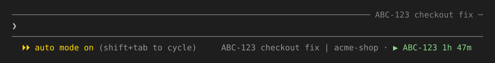
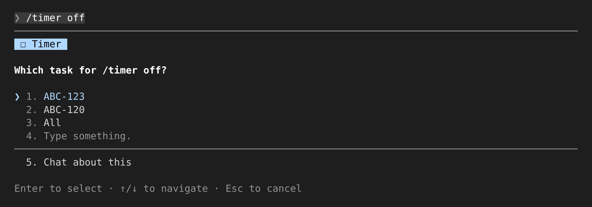
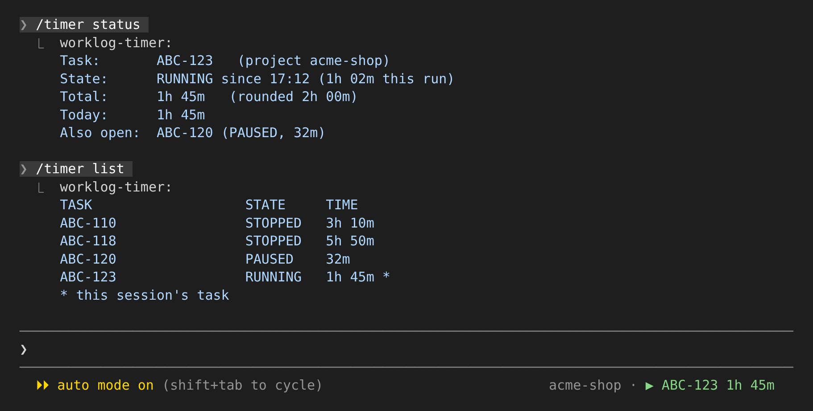

#  Claude Code timer

[](https://github.com/jfeid/claude-timer/actions/workflows/test.yml)

Worklog Timer (`worklog-timer`) is a Claude Code plugin for tracking work
time per task. Timers are kept per project (the git repository) and survive
session restarts, so a timer started in one session can be paused or stopped
from another. Reports round time up to the quarter hour for billing.

The running timer is also shown at the right of the prompt footer, so you can
see it in every session without asking:



## Install

At the prompt of a Claude Code terminal session:

```
/plugin install worklog-timer --marketplace jfeid/claude-timer
```

Answer `y` to add the marketplace, then pick a scope (user scope loads it in
every session). From a shell:
`claude plugin install worklog-timer --marketplace jfeid/claude-timer`.

On Windows, install [Git for Windows](https://gitforwindows.org/) first; see
[Requirements](#requirements).

Upgrading from version 0.2, when the plugin was named `timer`: run
`/plugin uninstall timer`, then the install line above. Logs are kept.

## Use

```
/timer on ABC-123          start or resume a task
/timer on ABC-1,ABC-2      start several tasks
/timer pause               pause the session's task
/timer off                 stop the session's task and print its total
/timer status              this session's task: state, since when, total, today
/timer list [STATE...]     every task, or only running, paused, stopped or open
/timer report [--split]    tracked and quarter-rounded totals
/timer day [DATE] [--all]  one day: per-task time, wall clock, timeline
/timer month [MM-YYYY]     billable hours per day and per task
```

`/timer` runs the script directly and prints its output, with no model turn,
so it is instant and costs no tokens. You can also just ask Claude ("start the
timer for ABC-123", "how long have I worked today?"); the plugin's skill runs
the same actions.

**The session's task** is the last single task you named in this session
with `on`, `pause`, `resume` or `off`. After `/timer on ABC-123`, a plain
`/timer pause`, `/timer on` or `/timer off` acts on ABC-123. When there is no
such task, or it is in the wrong state, you are asked which task to act on,
with `All` when there are several:





Overlapping tasks each count the full wall time by default; `--split` divides
shared time between them. Use the split figures when billing.

### The script

The plugin puts `timer.sh` on the Bash tool's PATH, so your own commands,
skills and scripts run by Claude can call it directly:

```
timer.sh list open               running and paused tasks of this project
timer.sh day yesterday --tsv     machine-readable rows
timer.sh month 08-2026 --tsv
timer.sh session-task            the task this session last named
timer.sh where                   path of this project's log
```

To let it run without a permission prompt, add `"Bash(timer.sh:*)"` to
`permissions.allow` in `~/.claude/settings.json`. The plugin's skill already
allows it for itself.

### The footer

`PROJECT · TIMER`:

- `PROJECT` is the timer project.
- `TIMER` is the session's task when it has a timer, else the first running
  task of the project. `▶` running, `⏸` paused, `⏹` stopped or no timer
  (`‖` and `■` on Windows, where the terminal draws the others as wide emoji).
- `+N running`: other tasks of the project running at the same time.

It refreshes every 30 seconds and right after any `timer.sh` call.

## Data

Everything stays on your computer; see [PRIVACY.md](PRIVACY.md).

- `~/.claude/timer/logs/<project>.tsv`: one file per project, with the columns
  `task`, `event` (`START`, `PAUSE`, `RESUME`, `STOP`), `epoch` and
  `timestamp`. Plain text; it can be edited by hand.
- `~/.claude/timer/sessions/<session id>`: the session's task, as
  `project<TAB>task` lines. Files untouched for 30 days are removed.

Settings, as environment variables:

| Variable | Default | Effect |
|---|---|---|
| `TIMER_HOME` | `~/.claude/timer` | where `logs/` and `sessions/` live |
| `TIMER_PROJECT` | git top-level folder name | force the project name |
| `TIMER_QUARTER` | `900` | rounding step in seconds |

## What the mod does

The `/timer` command and the footer come from `hooks/register.tsx`. It sends
nothing over the network and reads no file of Claude Code's own. In detail:

- **Programs it runs:** `git rev-parse --show-toplevel` in the session's
  folder, for the project name; `bin/timer.sh` with the `/timer` arguments,
  through bash. On Windows it runs `git --exec-path` to find Git Bash's
  `bash.exe`, unless `CLAUDE_CODE_GIT_BASH_PATH` names it.
- **What it reads:** the current project's log and this session's file under
  `~/.claude/timer/` (the plugin's own folder); the session's id and folder
  from Claude Code; and the variables `HOME`, `USERPROFILE`, `TIMER_HOME`,
  `TIMER_PROJECT` and `CLAUDE_CODE_GIT_BASH_PATH`. It reads no credentials.
- **What it asks:** when `timer.sh` cannot tell which task you mean, the mod
  asks you in Claude Code's question dialog, listing the tasks the script
  named, and runs the script again with your answer. It submits no prompts.
- **What it gives Claude:** the output of each `/timer` run, as context for
  the conversation.
- **Hooks:**
  - `command.run` answers `/timer` only.
  - `tool.call` on Bash passes every call on unchanged and refreshes the footer
    after one whose command mentions `timer.sh`.
  - `ui.render` on `SessionMode` draws the footer.
  - No hook makes or changes a permission decision.

## Requirements

- Claude Code 2.1.287 or later in the terminal (2.1.286 in the Desktop app's
  Code tab) for `/timer` and the footer, which are a mod. The plugin is for
  Claude Code only; claude.ai and Cowork do not install plugins with a
  `bin/` folder. On versions without mods, ask Claude in plain words and the
  skill runs the same actions.
- bash (3.2 or later) and the usual shell tools: present on Linux and macOS.
- Windows: [Git for Windows](https://gitforwindows.org/), which provides Git
  Bash. `/timer` runs the script with it, found through
  `CLAUDE_CODE_GIT_BASH_PATH` or next to `git`. Without it (PowerShell only)
  the script, `/timer` and the skill do not work.

Sandbox: with Claude Code's sandbox turned on, Claude's Bash tool cannot
write outside the project folder, so `timer.sh` run by Claude (plain-language
requests, your own commands and scripts) fails to save. Allow the timer's
folder in `~/.claude/settings.json`:

```json
{
  "sandbox": {
    "filesystem": {
      "allowWrite": ["~/.claude/timer"]
    }
  }
}
```

Merge it with any `allowWrite` entries you already have; use your
`TIMER_HOME` instead if you set one. `/timer` and the footer do not need it:
the mod runs `timer.sh` outside the sandbox.

Dates: with GNU `date` (Linux, Git Bash on Windows, or `gdate` from
`brew install coreutils` on macOS) `day` takes anything `date -d` reads, such
as `"last friday"`. With the macOS `date` it takes `today`, `yesterday`,
`tomorrow` or `YYYY-MM-DD`.

Used daily on Linux. CI runs the script's tests on Linux, macOS and Windows
(Git Bash), and the mod's tests on Linux; the `/timer` command and the footer
are tested by hand on Linux and Windows (Windows Terminal with Git for
Windows), not yet on macOS. Reports from other platforms are welcome in the
issues.

## Try it with sample data

`tests/sample-data.sh` writes three days of made-up tasks into a folder of
its own, without touching your real logs:

```
bash tests/sample-data.sh /tmp/timer-sample
export TIMER_HOME=/tmp/timer-sample TIMER_PROJECT=acme-shop
bin/timer.sh list          ABC-123 running, ABC-120 paused, two stopped
bin/timer.sh month         about 11.75 billable hours over 3 days
claude                     then /timer list, /timer off (asks which task)
```

There is no account or service to sign in to.

## Develop

```
claude --plugin-dir .          load this folder for one session
claude plugin validate --strict .
claude plugin test .           the mod's tests
bash tests/timer-cli.sh        timer.sh end to end (CI runs it on Linux, macOS, Windows)
```

## Security and support

Questions and bugs: [GitHub issues](https://github.com/jfeid/claude-timer/issues).
Security reports: see [SECURITY.md](SECURITY.md).

## License

MIT
